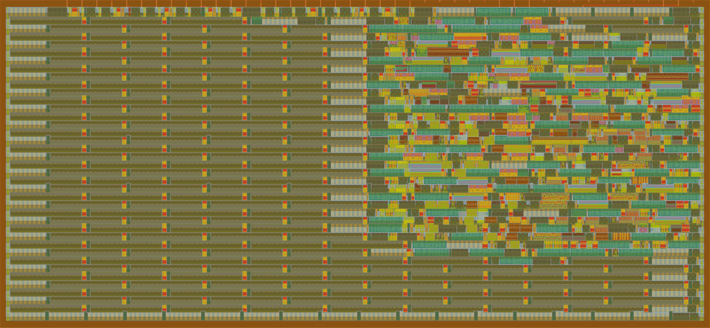

   

# PRGN over SPI

 

- [Read the documentation for project](docs/info.md)
- [Read the write-up](https://213742.xyz/blog/PRNG_over_SPI.pdf)

# What I Made

My design contains a 16-bit xorshift PRNG, with which you can interface over the SPI bus.
The design has been made to run at 16MHz, with the bus at 1MHz.

# How to Use It

## Initialization

Since reset is inverted, you need to pull it down for at least 5 clock cycles.
Afterwords pull it up, and wait for another 5 cycles.
You can test communication using the `0x01` command.
Next, you should initialize the PRNG using the `0x02` command, the seed cannot be equal to `0x00`.
On the next read using the `0x03` command,
the returned state should be equal to the value used to initialize the generator.

## Usage

You can read out the state using `0x03`, the internal state advances only after read.
